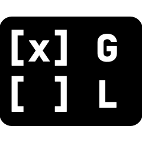
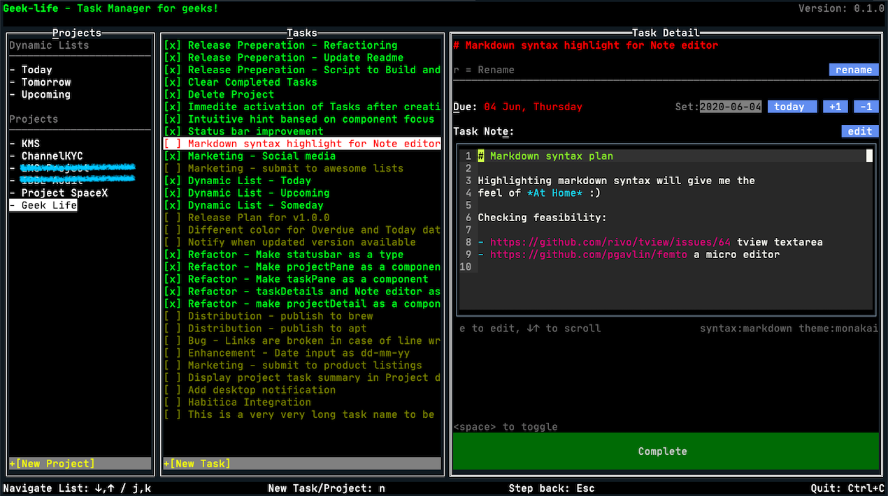

<p align="center">
    
</p>
<h1 align="center"> The CLI To-Do List / Task Manager for Geeks </h1>

<a href="https://www.producthunt.com/posts/geek-life?utm_source=badge-featured&utm_medium=badge&utm_souce=badge-geek-life" target="_blank"></a>
[](https://opensource.org/licenses/MIT)
[](https://goreportcard.com/report/github.com/ajaxray/geek-life)

:technologist: Developer / DevOps / Sysadmin? A command line hero?     
:computer: Live with the dark terminal?  
:memo: Think in Markdown?  

**Finally!** A full featured task manager for YOU! 


<a href="https://raw.githubusercontent.com/ajaxray/geek-life/master/media/geek-life_v1.gif" target="_blank">Click to see it moving (GIF)</a>
 

### :crystal_ball: Highlights

- Keyboard-first from end to end: Vim-style navigation, command palette, global search, and quick capture
- Fast task syntax: `Ship release #work !3 @tomorrow ~weekly +pin`
- Smart lists for today, overdue, upcoming, pinned, high-priority, completed, unscheduled, and trash
- Markdown task notes with syntax highlighting and external-editor support
- Paste clipboard images into task notes on Windows, then inspect their real pixels through automatic Sixel, Kitty, or iTerm backends
- Tags, four priority levels, pins, recurring tasks, completion timestamps, and project archiving
- Recoverable deletion with Trash and keyboard undo; confirmed permanent deletion for destructive actions
- Portable JSON backups from the command palette or command line
- Optional mouse support, with every primary workflow available from the keyboard

### :dart: Roadmap
- [x] Create Project
- [x] Delete Project
- [x] Edit Project
- [x] Create Task (under project)
- [x] Set Task due date (as `yyyy-mm-dd`) with shortcut
- [x] Set Task due date with quick input buttons (today, +1 day, -1 day)
- [x] Update Task Title
- [x] Tasklist items should indicate status (done, pending, overdue) using colors 
- [x] Export Tasks (Copy title, dueDate and description to clipboard as Markdown)
- [x] Pin Tasks
- [x] Shortcut for Adding new Project and Task
- [x] Global shortcuts for jumping to Projects or Tasks panel anytime
- [x] Cleanup all completed tasks of project
- [x] Task note editor should syntax highlight (markdown) and line numbers  
- [x] Status bar for common shortcuts
- [x] Status bar should display success/error message of actions
- [x] Status bar may display quick tips based on focused element
- [x] Dynamic lists 
    - Today
    - Overdue
    - Tomorrow 
    - Upcoming - Due in next 7 days
    - Unscheduled - tasks without due date
- [x] Cross-project structured search
- [x] Tags, priorities, pins, and recurring tasks
- [x] Trash, restore, and undo deletion
- [x] Command palette and in-app keyboard reference
- [x] JSON backup command
- [x] Full-screen image viewer with zoom and keyboard panning
- [ ] Integrations
    - todo.txt (coming soon...)
    - Google Tasks 
    - (Share your ideas)
- [ ] Time tracking

### :rocket: Ready for action (installing and running)

It's just a single binary file, **no external dependencies**. 
Just download the appropriate version of [executable from latest release](https://github.com/ajaxray/geek-life/releases) for your OS. 
Then rename and give it permission to execute.   
For example:
```bash
mv geek-life_linux-amd64 geek-life  
sudo chmod +x geek-life
./geek-life
```

I recommend installing it globally (to run from any directory of your system). It's easy, just put it in your systems $PATH directory.
```bash
sudo mv geek-life /usr/local/bin/geek-life
geek-life
```

Done! *Manage your tasks your way!* 

### Windows quick install (run from any terminal)

From the project root in PowerShell:

```powershell
powershell -ExecutionPolicy Bypass -File .\install.ps1
```

The installer finds Go from PATH or common Windows install locations (including
`C:\Program Files\Go`). You can also specify locations explicitly:

```powershell
.\install.ps1 -GoPath "C:\Program Files\Go\bin\go.exe"
.\install.ps1 -BinDir "$HOME\tools" -SkipPathUpdate
```

If Go is unavailable but a prebuilt `geek-life.exe` is present beside the
script, the installer installs that binary.

This will:
- build `geek-life.exe`
- install it to `%USERPROFILE%\\bin\\geek-life.exe`
- add `%USERPROFILE%\\bin` to your **User PATH** (if missing)

Then open a new terminal and run:

```powershell
geek-life
```

### Linux / CachyOS quick install (run from project root)

```bash
chmod +x ./install.sh
./install.sh
```

This will:
- build `geek-life`
- install it to `$HOME/.local/bin/geek-life`
- add `$HOME/.local/bin` to your shell PATH config if missing

Then open a new terminal and run:

```bash
geek-life
```

Optional flags:

```bash
./install.sh --skip-path-update
./install.sh --bin-dir=$HOME/bin
```

## :keyboard: Keyboard shortcuts

Shortcut key for a pane/element will be **marked with underline**.

Some shortcuts are global, some are contextual. 
Contextual shortcuts will be applied according to focused pane/element.  
You'll see a currently focused pane bordered with double line. 
 

In case writing in a text input (e,g, new project/task, due date), you have to `Enter` to submit/save. 

Press `?` anywhere in the app for the complete, scrollable keyboard reference.

| Context | Shortcut | Action |
| --- | :---: | --- |
| Global | `:` / `Ctrl+P` | Open the fuzzy command palette |
| Global | `/` | Search every active task |
| Global | `?` | Open keyboard help |
| Global | `p` / `t` | Focus Projects / Tasks |
| Global | `Ctrl+N` | Start a task in the active project |
| Lists | `j` / `k`, arrows, `Tab` | Move down / up |
| Lists | `Enter` / `Esc` | Open / move back |
| Projects | `n` | Create a project |
| Project actions | `r` / `a` / `c` / `d` | Rename, archive, clear completed, permanently delete |
| Tasks | `n` | Quick-add a task |
| Tasks | `Space` / `!` / `s` | Complete, cycle priority, pin |
| Tasks | `[` / `]` | Reorder inside a project |
| Tasks | `D` / `u` | Move to Trash / undo or restore |
| Task detail | `e` / `v` | Edit note in-app / in `$EDITOR` |
| Task detail | `d` / `g` / `R` | Edit due date, tags, recurrence |
| Task detail | `i` / `Ctrl+V` | Paste a clipboard image on Windows |
| Task detail | `o` / `O` | Open real-pixel / compatibility cell image viewer |
| Task detail | `r` / `x` | Rename / export Markdown |
| Cell image viewer | `n` | Switch to the native-pixel viewer |
| Cell image viewer | `+` / `-`, `1`-`9` | Zoom in/out or select a zoom level |
| Image viewer | `h` `j` `k` `l` / arrows | Pan the zoomed image |
| Image viewer | `b` | Toggle font-dependent sextant/color mode |
| Image viewer | `f`, `[` / `]`, `Esc` | Fit, change image, close |
| Note editor | `Esc` | Save and leave the editor |

### Quick capture and search

Metadata is optional and can be added while typing a task title:

```text
Ship release #work #terminal !3 @tomorrow ~weekly +pin
```

- Priorities: `!1`, `!2`, `!3` (or `!low`, `!medium`, `!high`)
- Dates: `@today`, `@tomorrow`, `@week`, or `@yyyy-mm-dd`
- Recurrence: `~daily`, `~weekly`, `~monthly`, or `~yearly`
- Any number of `#tags`, plus `+pin`

Search is token-based and combines filters. For example:

```text
installer #work @geek !2 is:open due:overdue
```

Supported filters include `#tag`, `@project`, minimum priority (`!2`),
`is:done`, `is:open`, `is:pinned`, `is:recurring`, `due:today`,
`due:tomorrow`, `due:overdue`, `due:none`, and `due:yyyy-mm-dd`.

**Tips about using shortcuts efficiently:**  

The interface has 3 primary panels
1. [**P**]rojects/Task lists
2. [**T**]asks of selected project or Tasklist
3. [**D**]etails/actions of selected Project or Task

The following diagram shows navigation shortcuts between the panels.
```
+------+----------------------+-----------------------+
|  P   |         T            |         D             |
|      |                      |                       |
|    Entr=>    ↓   ↑        Entr=>                    |
|      |       /   /          |                       |
|   <=Esc      j   k        <=Esc                     |
|      |                      |                       |
+------+----------------------+-----------------------+
```

So, what it's trying to visualize is -
- Selecting an item with `Enter` will move you to right panel. That means - 
    - Selecting a Project will load it's tasks and move to Tasks panel
    - Selecting a Task will load task detail and move to Detail panel
- Use `Esc` to move back to left panel. From Details to Tasks to Projects.
- To navigate a list (Project list or Task list), 
    - Use `↓` or `j` or `Tab` to go down
    - Use `↑` or `k` or `Shift+Tab` to go up  

Some More hints:
- If you are a vim user, think like -`j`/`k` for up/down list and `h` for go left 
- Think `Esc` as a "step back" - to previous pane in most cases.
- When you're in a list (Projects or Tasks), `Enter` will load currently selected item.
- After creating new Project, focus will automatically move to Tasks. Start adding tasks immediately by pressing `n`.   
- After creating new Task, focus will stay in "new task" input. So that you can add tasks quickly one after another. 
- After creating new Task, Press `Esc` when you're done creating tasks. 

## :hammer_and_wrench: Building blocks

- Built with [Go](https://go.dev/) 1.24+ *(you don't need Go to run a prebuilt binary)*
- Designed with [tview](https://github.com/rivo/tview) - interactive widgets for terminal-based UI
- Task Note editor made with [femto](https://github.com/pgavlin/femto)  
- Datastore is [storm](https://github.com/asdine/storm) - a powerful toolkit for [BoltDB](https://github.com/etcd-io/bbolt)

### Contribute

If you fix a bug or want to add/improve a feature, 
and it's aligned with the focus (merging with ease) of this app, 
I will be glad to accept your PR. :) 

## :bulb: You may ask...

#### :question: Where is the data stored? Can I change the location?

By default, it will try to create a db file in you home directory. 

But as a geek, you may try to put it different location (e,g, in your dropbox for syncing).
In that case, just mention `DB_FILE` as an environment variable.
 
```bash
DB_FILE=~/dropbox/geek-life/default.db geek-life
```

Pasted images are stored in an `attachments` directory beside the database.
They are also referenced from the task note as Markdown. The in-app preview
uses terminal true color and block characters, so its fidelity depends on the
terminal's color support. The side panel is a compact thumbnail; press `o` to
open the full-terminal viewer, then use `1`-`9` to zoom and arrows or
`h`/`j`/`k`/`l` to pan. Press `b` for a higher-resolution monochrome mode that
preserves much more detail in screenshots, text, and diagrams. Geek-life
automatically selects that mode when an image looks like a document or
screenshot; `b` always lets you override it.

#### :question: How do I back up my data?

Choose **Create JSON backup** from the command palette, or run:

```bash
geek-life backup
geek-life backup /path/to/geek-life-backup.json
```

Automatic backup filenames are written under `backups` beside the database.
The JSON includes active and archived projects plus active and trashed tasks.
It records attachment paths but does not embed image bytes; copy the neighboring
`attachments` directory as well when making a full disaster-recovery backup.

#### :question: How can I suggest a feature?

Just [post an issue](https://github.com/ajaxray/geek-life/issues/new) describing your desired feature/enhancement 
and select `feature` label.

Also, incomplete features in the current roadmap will be found in issue list. 
You may :thumbsup: issues if you want to increase priority of a feature.

---
### Footnotes 
1. In my Macbook Air, 1.6 GHz Dual-Core Intel Core i5, RAM: 8 GB 1600 MHz DDR3
2. Using [monakai](https://github.com/sickill/vim-monokai) color scheme for markdown syntax
---
> "This is the Book about which there is no doubt, a guidance for those conscious of Allah" - [Al-Quran](http://quran.com)
